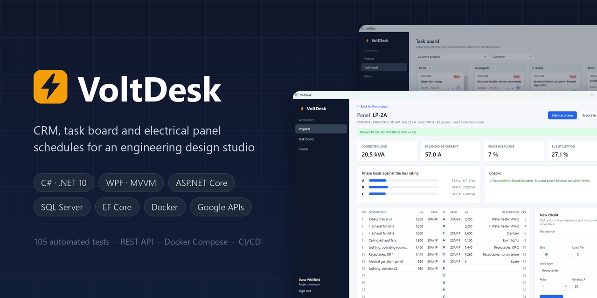
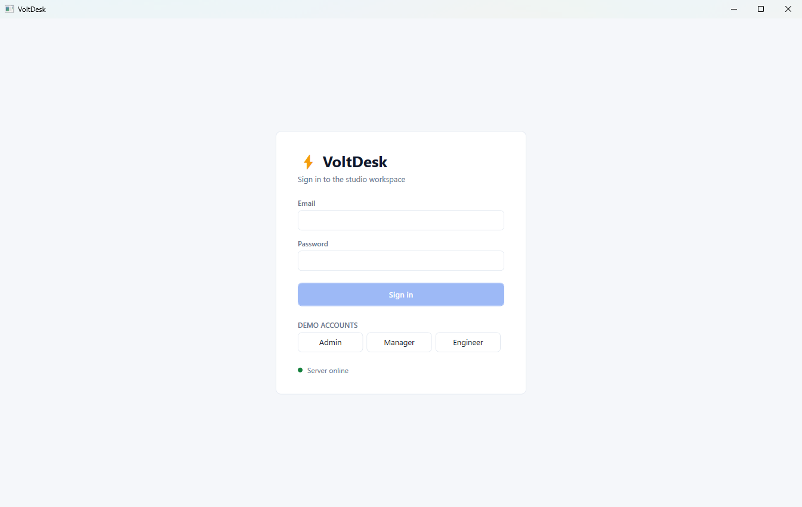
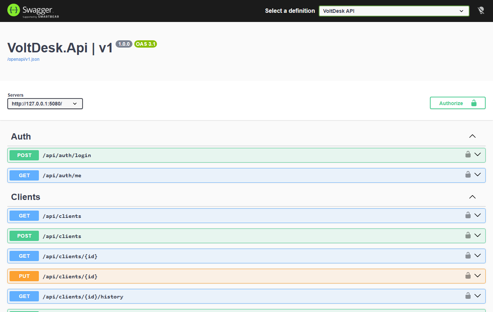
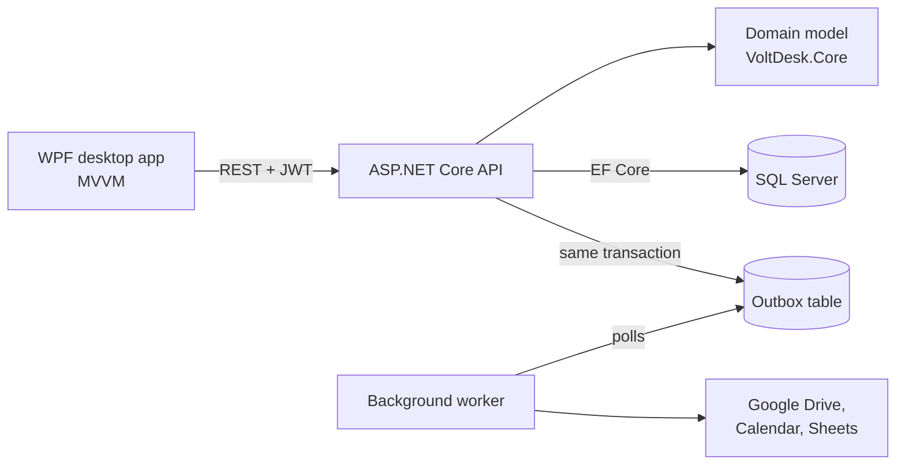

<p align="center">
  
</p>

<p align="center">
  <a href="https://github.com/kyrylo-papuk/VoltDesk/actions/workflows/ci.yml"></a>
  <a href="https://github.com/kyrylo-papuk/VoltDesk/releases/latest"></a>
  
  
  
  
  <a href="LICENSE"></a>
</p>

<p align="center">
  <a href="#try-it-in-two-minutes">Try it</a> ·
  <a href="#screenshots">Screenshots</a> ·
  <a href="#architecture">Architecture</a> ·
  <a href="#panel-schedules">Panel schedules</a> ·
  <a href="#google-workspace">Google Workspace</a> ·
  <a href="#tests">Tests</a>
</p>

**VoltDesk** is an internal system for an electrical design studio that works on US building
projects: hospitals, data centers, factories, offices. Everything the studio runs on lives in one place:
- client CRM;
- projects tracked through the design stages;
- a task board;
- electrical panel schedules with load calculations and automatic phase balancing.

Google Workspace automation creates the project folders in Drive, keeps stage deadlines in
Calendar and writes reports to Sheets.

It is a complete product, not a demo screen:
- WPF desktop client;
- ASP.NET Core API;
- SQL Server;
- background integration worker;
- 105 automated tests;
- Docker image;
- a CI/CD pipeline that ships a one-file Windows app.

<p align="center">
  
</p>

## Highlights

- ⚡ **Real engineering domain.** Panel schedules are modelled like real panelboards:
  - slot numbering and phase rows;
  - multi-pole breakers;
  - NEC breaker sizing at 125%;
  - NEMA phase imbalance;
  - bus and main breaker checks;
  - a balancing algorithm that takes the demo panel from **90% to 7%** imbalance.
- 🧩 **Business rules live in the domain model**, not in controllers:
  - a design stage cannot close while it has open tasks;
  - deadlines follow the stage order;
  - a task cannot start without an assignee.
- 🔒 **Optimistic concurrency at aggregate level.** SQL Server `rowversion` catches a stale edit of a contact, milestone or circuit even when only a child row changes.
- 📜 **Audit log** of every property change, written in the same transaction as the data.
- 📤 **Transactional outbox** for Google sync. A user's request never waits on Google and never fails because of it; a background worker retries with exponential back-off and never creates duplicates.
- 🛡️ **Security done properly:**
  - JWT roles are re-checked against the database on every request, so deactivating someone takes effect immediately;
  - sign-in is rate-limited;
  - an unknown email takes about as long to reject as a wrong password;
  - Google access is least-privilege;
  - secrets stay out of the repository;
  - the container runs as non-root.
- ✅ **105 automated tests:** 65 domain unit tests, plus 40 integration tests that run the real API against SQL Server in a throwaway container.

## Try it in two minutes

You need Docker and Windows 10 or 11 (x64).

1. **Start the server** with demo data:

   ```bash
   git clone https://github.com/kyrylo-papuk/VoltDesk.git
   cd VoltDesk
   docker compose up -d
   ```

   This starts SQL Server and the API on http://localhost:5080 (Swagger UI at http://localhost:5080/swagger).
   The API creates the database and loads demo data on first start.

2. **Start the desktop app.** Download `VoltDesk-<version>-win-x64.zip` from
   [Releases](https://github.com/kyrylo-papuk/VoltDesk/releases/latest), unzip it and run `VoltDesk.Desktop.exe`.
   No .NET install is needed. The app is not code-signed, so Windows SmartScreen may ask:
   choose *More info → Run anyway*. You can also run it from source with
   `dotnet run --project src/VoltDesk.Desktop`.

3. **Sign in** with one of the demo account buttons, or with an email below and the password
   `VoltDesk-demo-2026`:

   | Email | Role | Can do |
   |---|---|---|
   | `avery.stone@voltdesk.example` | Admin | Everything, including managing employees |
   | `dana.whitfield@voltdesk.example` | Project manager | Clients, projects, tasks, panels |
   | `sam.ortega@voltdesk.example` | Engineer | Reads everything, works on tasks and panel schedules |

All companies and people in the demo data are fictional.

## Screenshots

| | |
|---|---|
|  |  |
| **Projects.** Stage and status at a glance; overdue stages in red | **Project card.** Stage timeline, panels, tasks, change history |
|  |  |
| **Panel schedule.** Phase A overloaded, an undersized breaker flagged | **After fixing the breaker and one click on Balance phases.** 90% → 7% imbalance |
|  |  |
| **Task board.** Drag and drop, filters, details panel | **Clients.** Contacts, one of them primary |
|  |  |
| **Sign-in.** Demo accounts and live server status | **REST API.** OpenAPI document and Swagger UI |

## Architecture



| Project | Purpose |
|---|---|
| [`src/VoltDesk.Core`](src/VoltDesk.Core) | Domain model and business rules; no infrastructure dependencies |
| [`src/VoltDesk.Infrastructure`](src/VoltDesk.Infrastructure) | Infrastructure services, listed below |
| [`src/VoltDesk.Contracts`](src/VoltDesk.Contracts) | Request and response DTOs shared by the API and the desktop app |
| [`src/VoltDesk.Api`](src/VoltDesk.Api) | REST API: controllers, JWT auth, error mapping, OpenAPI |
| [`src/VoltDesk.Desktop`](src/VoltDesk.Desktop) | WPF client |
| [`tests/VoltDesk.Core.Tests`](tests/VoltDesk.Core.Tests) | Unit tests for the domain rules and panel calculations |
| [`tests/VoltDesk.Api.Tests`](tests/VoltDesk.Api.Tests) | Integration tests: the real API on SQL Server in a container, with Google faked |
| [`tools/VoltDesk.GoogleAuth`](tools/VoltDesk.GoogleAuth) | One-time Google sign-in that prints a refresh token |

`VoltDesk.Infrastructure` holds:
- EF Core persistence and migrations;
- the audit log;
- the outbox;
- the Google integration;
- Excel export;
- demo data.

**Stack:**
- C# 14 and .NET 10;
- WPF with CommunityToolkit.Mvvm and Generic Host;
- ASP.NET Core;
- EF Core 10 on SQL Server 2025;
- JWT;
- Google Drive, Calendar and Sheets APIs;
- ClosedXML;
- xUnit v3 with Testcontainers;
- Docker;
- GitHub Actions.

### Design decisions

- **Optimistic concurrency.**
  - Clients, projects, tasks, panels and employees have a SQL Server `rowversion`.
  - Every DTO carries it as `Version`, and every change sends it back.
  - Editing a contact, milestone or circuit also touches the parent row, so a stale edit of a child is caught at aggregate level.
- **Audit log.** Every save records who changed which property, and from what to what, in the same transaction as the data. History is grouped by aggregate, and password hashes are masked.
- **No repository layer.** `DbContext` already is a unit of work.
  - Writes: a controller loads an aggregate, calls a domain method and saves.
  - Reads: `AsNoTracking` projections straight into DTOs.
- **Persistence stays out of the domain.** Rowversion and timestamps are shadow properties, and links to Google objects live in their own table.
- **No retrying execution strategy.** Each save opens one transaction for the data and its audit entries, and a retrying strategy cannot safely replay that. Startup waits for SQL Server instead.
- **Panels reference projects by id** as separate aggregates, so editing a schedule never locks or conflicts with the project itself.

## Domain

| Entity | What it holds |
|---|---|
| Client | Customer company and its contacts, one of them primary |
| Employee | Studio staff: engineers, project managers, admins |
| Project | Design contract for one building: number, client, location, fee, manager, current design stage |
| Milestone | Due date and completion of each design stage: SD → DD → CD → Permit → CA |
| Task | Work item in a stage: discipline (power, lighting, fire alarm, low voltage), assignee, status, estimate |
| Electrical panel | Panelboard of a project: voltage system, bus, main breaker, spaces and circuits |

The business rules live in `VoltDesk.Core` and are covered by unit tests:

- **Project stages**
  - A project moves through the design stages in order.
  - A stage cannot be closed while it has open tasks.
  - Closing Construction Administration completes the project.
  - Stage due dates must follow the stage order, and completed stages cannot be rescheduled.
- **Project managers.** Only active project managers and admins can manage a project.
- **Projects on hold or closed**
  - They cannot get new tasks.
  - Their tasks and panels are read-only.
- **Tasks**
  - A task cannot leave To Do without an assignee.
  - Moving a task to Done records the completion date.
- **Contacts**
  - A contact needs an email or a phone number.
  - Each client has exactly one primary contact.
  - A client cannot have two contacts with the same email; a filtered unique index enforces this as well.
- **Stored values**
  - Locations use real US state codes.
  - Enums are stored as readable strings in the database.

## Panel schedules

A panel is modelled like the real thing:
- Circuit numbers are slots: odd numbers on the left, even on the right.
- Each row of two slots sits on the next phase in turn: A, B, C, A, B, C…
- A two-pole breaker at slot 1 takes slots 1 and 3 (phases A and B); a three-pole breaker takes 1, 3 and 5.

| Check or calculation | Rule |
|---|---|
| Phase load | Sum of VA per phase; a multi-pole load is split evenly over its poles |
| Phase current | Phase VA / line-to-neutral voltage (120 V or 277 V) |
| Balanced current | Total VA / (√3 × line-to-line voltage) |
| Phase imbalance | NEMA definition: largest deviation from the average current, over the average |
| Breaker size | Load current × 125% must not exceed the breaker rating (NEC 210.20(A)); ratings come from NEC 240.6(A) |
| Bus and main | Heaviest phase against the bus rating and, at 125%, against the main breaker |

**Phase balancing** rearranges the circuits across the slots with a greedy longest-processing-time pass:
1. Three-pole and two-pole breakers are placed first.
2. Single-pole loads follow, from largest to smallest.
3. Each circuit goes where it leaves the most loaded phase lightest.

The new layout is kept only if it is better than the old one.

**Excel export** writes the schedule with a VA column for each phase. Their totals are `SUM` formulas,
so the workbook stays correct when someone edits a load by hand.

## Google Workspace

Optional and off by default; everything else works without it. When switched on:

| Trigger | Result in Google |
|---|---|
| Project created | Drive folder `<number> <name>` under "VoltDesk projects", linked on the project card (contents below) |
| Milestone scheduled, moved or closed | One all-day Calendar event per stage, updated in place (✓ once the stage is closed) |
| "Save to Drive" on a panel | The schedule workbook uploaded to the project's Panel schedules folder |
| "Workload → Google Sheets" on the board | A new sheet with each employee's open tasks, overdue tasks and estimated hours |

The project folder contains:
- a subfolder for each design stage;
- Calculations;
- Panel schedules;
- Correspondence.

**How the transactional outbox works.**
1. Project and milestone changes write an event to an outbox table, in the same transaction as the change.
2. A background worker delivers the events to Google with exponential back-off: 30 s, 1 min, 2 min and so on, up to eight attempts. A Google outage never fails or slows down a user's request.
3. Drive folders and calendar events are remembered as soon as they are created, so a retry continues where it stopped instead of creating duplicates.
4. These links live outside the aggregates. Background sync never changes a project's version, so it never causes a false "changed by someone else".

Access is least-privilege: `drive.file` (only the files the app created) and `calendar.events`.

<details>
<summary><b>How to switch it on</b></summary>

1. In Google Cloud Console, create a project and enable the Drive, Calendar and Sheets APIs.
2. Configure the OAuth consent screen (External, testing) and add the studio account as a test user.
3. Create an OAuth client ID of type **Desktop app**.
4. Get a refresh token: `dotnet run --project tools/VoltDesk.GoogleAuth -- <client-id> <client-secret>`
5. Store the settings in user secrets, never in the repository:

```bash
cd src/VoltDesk.Api
dotnet user-secrets set Google:Enabled true
dotnet user-secrets set Google:ClientId <client-id>
dotnet user-secrets set Google:ClientSecret <client-secret>
dotnet user-secrets set Google:RefreshToken <refresh-token>
```

</details>

## Desktop app

| Screen | What it does |
|---|---|
| Sign-in | Email and password, demo account shortcuts, live server status |
| Projects | Search and status filter, stage and status badges, overdue stage dates in red |
| Project card | Stage timeline with editable due dates; close stage, hold, resume, cancel; panels, tasks by stage, change history |
| Panel schedule | Totals, phase load bars against the bus, checks, a two-sided schedule with clickable slots, circuit editor, balancing, Excel export |
| Task board | Kanban of tasks in active projects: drag cards or use the arrows, filter by project and assignee, edit and assign in a side panel |
| Clients | Client list with search, contacts with a primary flag, add and remove contacts |

- **MVVM throughout** with CommunityToolkit.Mvvm:
  - pages are view models, and `DataTemplate`s pick their views;
  - navigation keeps a back stack;
  - services come from the Generic Host.
- **A custom flat theme** with templated buttons, inputs, combo boxes, data grids and badges.
- **Role-aware actions.** The app shows only the actions your role allows, and the server enforces the same rules.
- **Optimistic board moves.** A card moves at once; if the server refuses the move, it goes back and the server's reason is shown.
- **Graceful failures**:
  - a version conflict reloads the record and says why;
  - an expired session returns to the sign-in screen.
- **Blank window?** If WPF renders a blank window (on some VMs and remote sessions), set `VOLTDESK_SOFTWARE_RENDERING=1`.

## API

The REST API lives under `/api`, documented with OpenAPI (Swagger UI at `/swagger`).

<details>
<summary><b>Endpoints, roles and error responses</b></summary>

| Area | Endpoints |
|---|---|
| Auth | `POST /auth/login`, `GET /auth/me` |
| Clients | List with search, details, create, rename, add / edit / remove contacts, history |
| Projects | List with filters, details with milestones and tasks, create, edit, change manager, schedule milestones, advance / hold / resume / cancel, history |
| Tasks | List, my open tasks, create, edit, assign, move on the board |
| Panels | List per project, create, edit, add / edit / move / remove circuits, balance phases, Excel export, save to Drive, history |
| Integrations | Google status, workload report to Google Sheets |
| Employees | List, create, change role, deactivate / reactivate |

**Roles:**
- **Engineers** read everything, work on tasks and edit panel schedules.
- **Project managers** can also manage clients, projects and tasks.
- **Admins** can also manage employees.

**Errors** are RFC 7807 problem responses, which the desktop app shows as they are:

| Status | When |
|---|---|
| 400 | Request validation failed, or the version token is malformed |
| 401 / 403 | Not signed in / role not allowed |
| 409 | Someone else changed the record (stale version), or the number, name or email is already taken |
| 422 | A business rule was violated, e.g. closing a stage with open tasks |
| 429 | Too many sign-in attempts |
| 503 | A Google feature was used while the integration is off |

</details>

## Tests

| Suite | Tests | What it covers |
|---|---:|---|
| `VoltDesk.Core.Tests` | 65 | Domain rules: stages, milestones, tasks, contacts, panel slots and phases, breaker sizing, imbalance, balancing |
| `VoltDesk.Api.Tests` | 40 | Real HTTP calls against the API on SQL Server in a Testcontainers container (details below) |

The integration tests cover:
- auth and roles;
- concurrency conflicts;
- the audit log;
- panels and Excel export;
- Google sync through a fake workspace, including outages and retries.

The CI workflow has two jobs:
- **Windows:** builds every project, including WPF, and runs the unit tests.
- **Ubuntu:** runs the integration tests against SQL Server in a Linux container.

The release workflow runs when a `v*` tag is pushed:
- the self-contained desktop app is published to GitHub Releases;
- the API image is published to GitHub Container Registry.

<details>
<summary><b>Develop locally</b></summary>

Requires the .NET 10 SDK and Docker.

```bash
docker compose up -d db                  # only SQL Server, on 127.0.0.1:1433
dotnet run --project src/VoltDesk.Api    # API on http://localhost:5080, migrates and seeds in Development
dotnet run --project src/VoltDesk.Desktop
dotnet test                              # unit + integration tests (Docker required)
```

Outside Development, set `ConnectionStrings__VoltDesk` and `Jwt__SigningKey` (32+ characters).

```bash
dotnet tool restore                      # dotnet-ef, pinned in dotnet-tools.json
dotnet ef migrations add <Name> --project src/VoltDesk.Infrastructure \
  --startup-project src/VoltDesk.Api --output-dir Persistence/Migrations
```

</details>

## Build history

The project was built in phases, one commit per phase:

1. Solution skeleton, SQL Server in Docker, CI
2. Domain and EF Core: clients, projects, design stages, tasks
3. REST API: auth, roles, audit log, optimistic concurrency, integration tests
4. Desktop: sign-in, projects, project card, clients
5. Desktop: task board with drag and drop
6. Panel schedules: load calculation, phase balancing, Excel export
7. Google Drive, Calendar and Sheets through a transactional outbox
8. Packaging: Docker image, full-stack Compose, self-contained desktop release

## License

[MIT](LICENSE)
