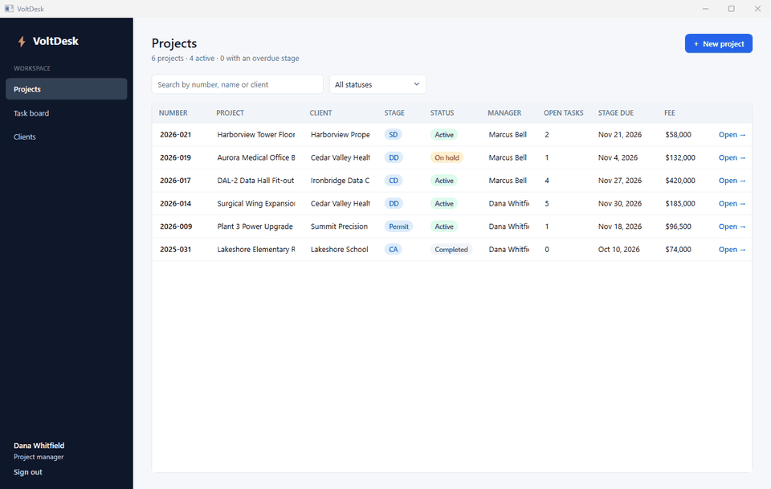
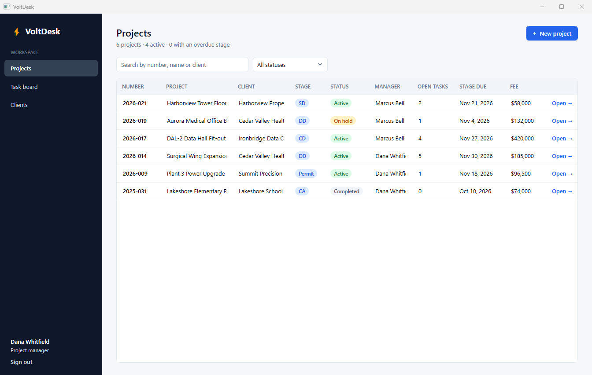
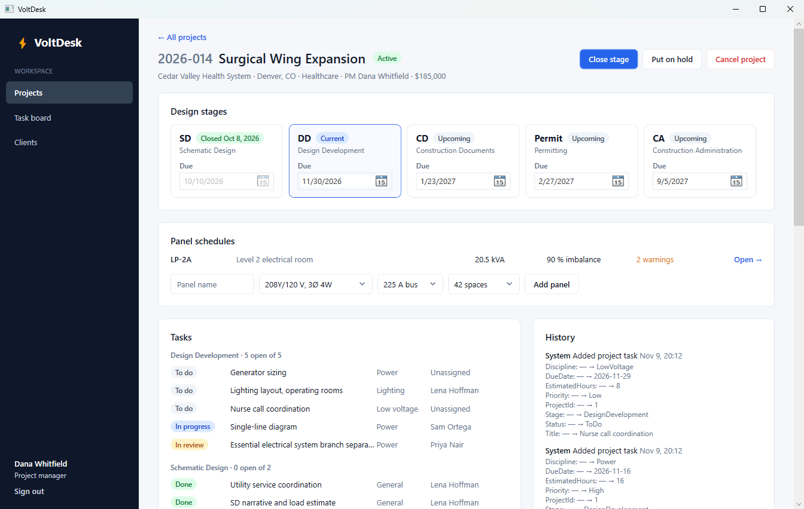
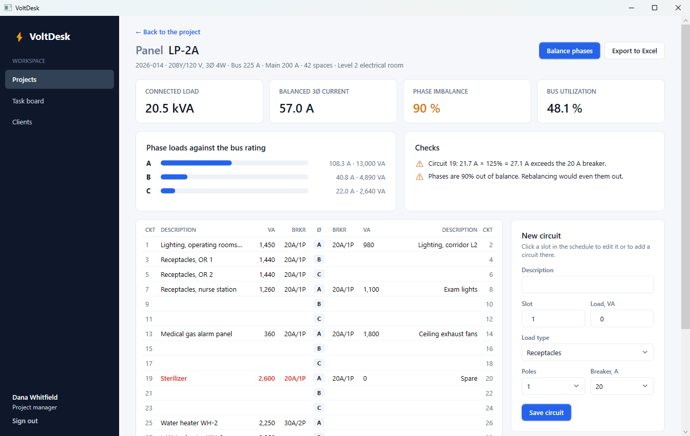
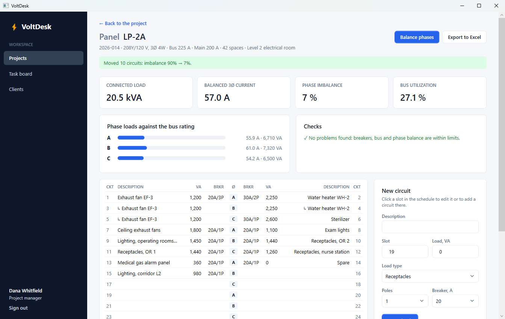
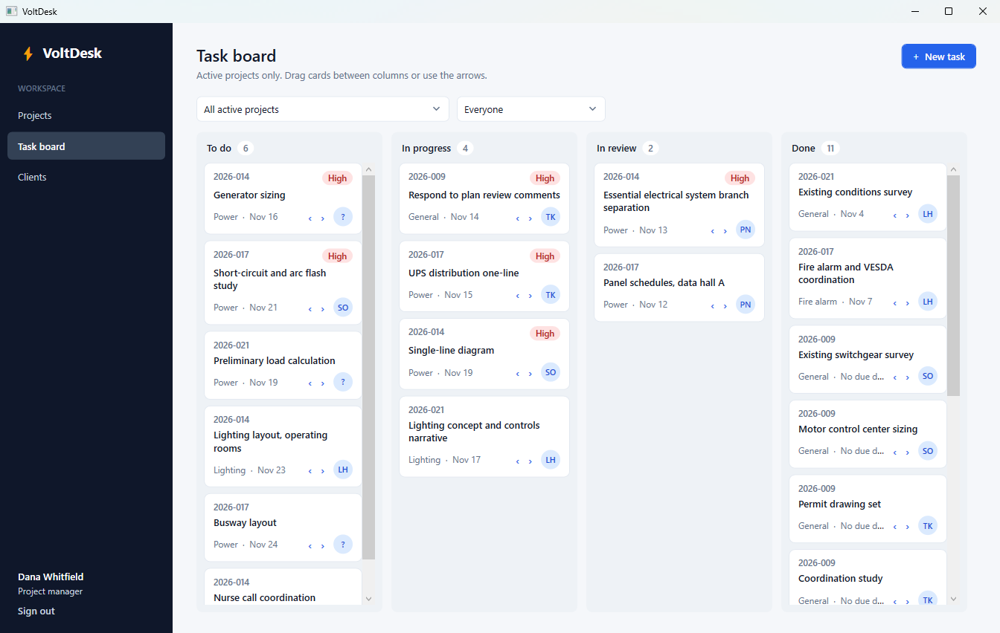
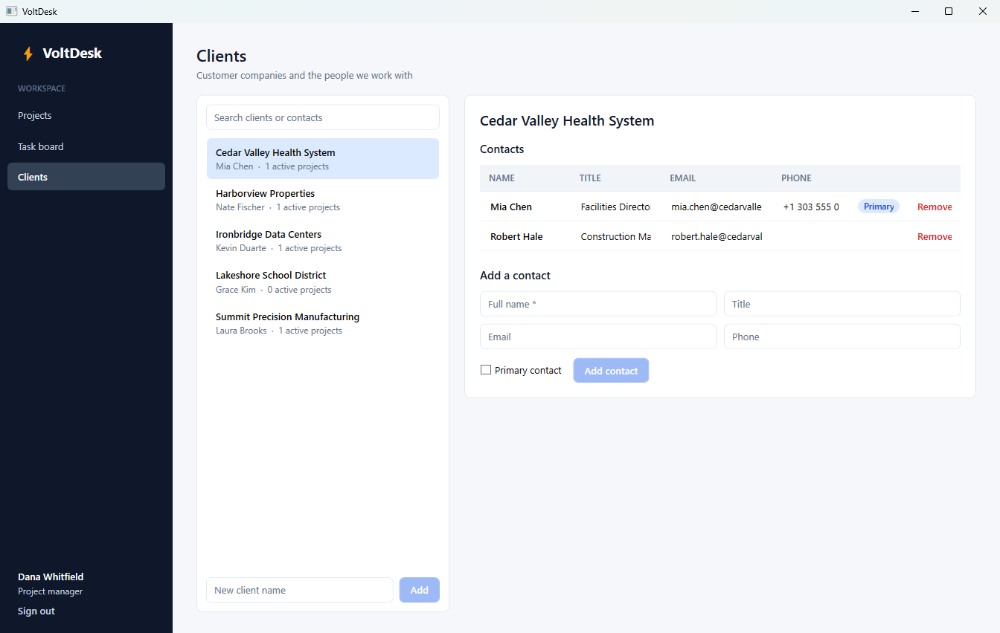
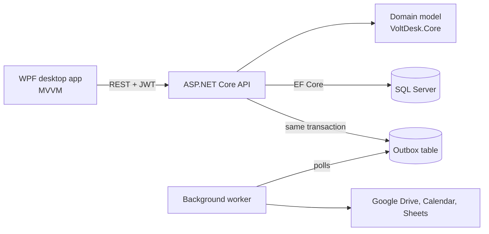

# VoltDesk

Internal desktop system for an electrical design studio that works on US building projects
(hospitals, data centers, factories, offices): client CRM, projects tracked by design stage,
a task board, and electrical panel schedules with load calculations and automatic phase balancing.
Optional Google Workspace automation creates project folders in Drive, keeps stage deadlines in
Calendar and writes reports to Sheets.



**Stack:** C# · .NET 10 · WPF (MVVM) · ASP.NET Core Web API · EF Core · SQL Server 2025 ·
JWT · Google Drive/Calendar/Sheets APIs · ClosedXML · xUnit v3 · Testcontainers · Docker · GitHub Actions

## Highlights

- **Real engineering domain.** Panel schedules modelled like actual panelboards: slot numbering,
  phase rows, multi-pole breakers, NEC breaker sizing at 125%, NEMA phase imbalance, bus and main
  checks, and a greedy balancing algorithm that takes the demo panel from 90% to 7% imbalance.
- **Business rules in the domain model**, not in controllers: a design stage cannot close with open
  tasks, deadlines follow stage order, a task cannot start without an assignee.
- **Optimistic concurrency** with SQL Server `rowversion` at aggregate level: a stale edit of a
  contact, milestone or circuit is caught even though only a child row changes.
- **Audit log** of every property change, written in the same transaction as the data.
- **Transactional outbox** for Google sync: user requests never wait for or fail because of Google;
  a background worker retries with exponential back-off without creating duplicates.
- **Security basics done properly:** JWT with roles checked against the database on every request
  (deactivation is immediate), rate-limited sign-in, constant-time-ish failure for unknown emails,
  least-privilege Google scopes, secrets outside the repository, non-root container.
- **105 automated tests:** 65 unit tests on the domain, 40 integration tests running the real API
  against SQL Server in a throwaway container.

## Screenshots

| | |
|---|---|
|  |  |
| **Projects**: stage and status at a glance, overdue stages in red | **Project card**: stage timeline, panels, tasks, change history |
|  |  |
| **Panel schedule**: phase A overloaded, undersized breaker flagged | **After fixing the breaker and balancing**: 90% → 7% imbalance |
|  |  |
| **Task board**: drag and drop, filters, details panel | **Clients**: contacts with a primary contact |

## Try it

1. Start SQL Server and the API with demo data (requires Docker):

   ```bash
   docker compose up -d
   ```

   The API listens on http://localhost:5080 (Swagger UI at http://localhost:5080/swagger).

2. Start the desktop app: download `VoltDesk-<version>-win-x64.zip` from the Releases page and run
   `VoltDesk.Desktop.exe` (self-contained, no .NET install needed), or run it from source with
   `dotnet run --project src/VoltDesk.Desktop`.

3. Sign in with a demo account button, or with one of these (password `VoltDesk-demo-2026`):

| Email | Role |
|---|---|
| `avery.stone@voltdesk.example` | Admin |
| `dana.whitfield@voltdesk.example` | Project manager |
| `sam.ortega@voltdesk.example` | Engineer |

All companies and people in the demo data are fictional.

## Architecture



| Project | Purpose |
|---|---|
| `src/VoltDesk.Core` | Domain model and business rules, no infrastructure dependencies |
| `src/VoltDesk.Infrastructure` | EF Core persistence, migrations, audit log, outbox, Google integration, Excel export, demo data |
| `src/VoltDesk.Contracts` | Request and response DTOs shared by the API and the desktop app |
| `src/VoltDesk.Api` | REST API: controllers, JWT auth, error mapping, OpenAPI |
| `src/VoltDesk.Desktop` | WPF client |
| `tests/VoltDesk.Core.Tests` | Unit tests for the domain rules and panel calculations |
| `tests/VoltDesk.Api.Tests` | Integration tests: real API + SQL Server in a container, Google faked |
| `tools/VoltDesk.GoogleAuth` | One-time Google sign-in that prints a refresh token |

## Domain

| Entity | What it holds |
|---|---|
| Client | Customer company and its contacts, one of them primary |
| Employee | Studio staff: engineers, project managers, admins |
| Project | Design contract for one building: number, client, location, fee, manager, current design stage |
| Milestone | Due date and completion of each design stage: SD → DD → CD → Permit → CA |
| Task | Work item in a stage: discipline (power, lighting, fire alarm, low voltage), assignee, status, estimate |
| Electrical panel | Panelboard of a project: voltage system, bus, main breaker, spaces and circuits |

Business rules live in `VoltDesk.Core` and are covered by unit tests:

- A project moves through the design stages in order. A stage cannot be closed while it has open tasks.
  Closing Construction Administration completes the project.
- Stage due dates must follow the stage order. Completed stages cannot be rescheduled.
- Only active project managers and admins can manage a project.
- Projects on hold or closed cannot get new tasks, and their tasks and panels are read-only.
- A task cannot leave To Do without an assignee. Done records the completion date.
- A contact needs an email or a phone number. Each client has exactly one primary contact and
  no duplicate contact emails (also enforced by a filtered unique index).
- Locations use real US state codes. Enums are stored as readable strings in the database.

## Panel schedules

A panel is modelled like the real thing: circuit numbers are slots, odd on the left and even on the
right, and each row of two slots sits on phase A, B, C, A, B, C… in turn. A two-pole breaker at
slot 1 takes slots 1 and 3 (phases A and B); a three-pole breaker takes 1, 3, 5.

| Check / calculation | Rule |
|---|---|
| Phase load | Sum of VA per phase; a multi-pole load is split evenly over its poles |
| Phase current | Phase VA / line-to-neutral voltage (120 V or 277 V) |
| Balanced current | Total VA / (√3 × line-to-line voltage) |
| Phase imbalance | NEMA definition: largest deviation from the average current, over the average |
| Breaker size | Load current × 125% must not exceed the breaker (NEC 210.20(A)); ratings from NEC 240.6(A) |
| Bus and main | Heaviest phase against the bus rating and, at 125%, against the main breaker |

**Phase balancing** rearranges circuits across slots with a greedy longest-processing-time pass:
three- and two-pole breakers first, then single-pole loads from largest to smallest, each placed
where it leaves the most loaded phase lightest. The new layout is kept only if it is better.

**Excel export** writes the schedule with per-phase VA columns whose totals are `SUM` formulas,
so the workbook stays correct when someone edits a load by hand.

## Google Workspace

Optional and off by default; everything else works without it. When switched on:

| Trigger | Result in Google |
|---|---|
| Project created | Drive folder `<number> <name>` under "VoltDesk projects" with stage subfolders, Calculations, Panel schedules, Correspondence; linked on the project card |
| Milestone scheduled, moved or closed | One all-day Calendar event per stage, updated in place (✓ once the stage is closed) |
| "Save to Drive" on a panel | The schedule workbook uploaded to the project's Panel schedules folder |
| "Workload → Google Sheets" on the board | A new sheet with every employee's open tasks, overdue tasks and estimated hours |

**Transactional outbox.** Project and milestone changes write an event to an outbox table in the
same transaction as the change. A background worker delivers events to Google with exponential
back-off (30 s, 1 min, 2 min…, eight attempts), so a Google outage never fails or slows down a
user's request. Created Drive folders and calendar events are remembered as they are made, so a
retry continues instead of duplicating. These links live outside the aggregates: background sync
never changes a project's version and never causes a false "changed by someone else".

Access is least-privilege: `drive.file` (only files the app created) and `calendar.events`.

To switch it on:

1. In Google Cloud Console create a project and enable the Drive, Calendar and Sheets APIs.
2. Configure the OAuth consent screen (External, testing) and add the studio account as a test user.
3. Create an OAuth client ID of type **Desktop app**.
4. Get a refresh token: `dotnet run --project tools/VoltDesk.GoogleAuth -- <client-id> <client-secret>`
5. Store the settings in user secrets (never in the repository):

```bash
cd src/VoltDesk.Api
dotnet user-secrets set Google:Enabled true
dotnet user-secrets set Google:ClientId <client-id>
dotnet user-secrets set Google:ClientSecret <client-secret>
dotnet user-secrets set Google:RefreshToken <refresh-token>
```

## API

REST API under `/api`, documented with OpenAPI (Swagger UI at `/swagger`).

| Area | Endpoints |
|---|---|
| Auth | `POST /auth/login`, `GET /auth/me` |
| Clients | list with search, details, create, rename, add / edit / remove contacts, history |
| Projects | list with filters, details with milestones and tasks, create, edit, change manager, schedule milestones, advance / hold / resume / cancel, history |
| Tasks | list, my open tasks, create, edit, assign, move on the board |
| Panels | list per project, create, edit, add / edit / move / remove circuits, balance phases, Excel export, save to Drive, history |
| Integrations | Google status, workload report to Google Sheets |
| Employees | list, create, change role, deactivate / reactivate |

**Roles.** Engineers read everything, work on tasks and edit panel schedules. Project managers also
manage clients, projects and tasks. Admins also manage employees.

**Errors** are RFC 7807 problem responses the desktop app shows as is:

| Status | When |
|---|---|
| 400 | Request validation failed, or a malformed version token |
| 401 / 403 | Not signed in / role not allowed |
| 409 | Someone else changed the record (stale version), or a duplicate number, name or email |
| 422 | A business rule was violated, e.g. closing a stage with open tasks |
| 429 | Too many sign-in attempts |
| 503 | A Google feature was used while the integration is off |

## Design decisions

- **Optimistic concurrency.** Clients, projects, tasks, panels and employees have a SQL Server
  `rowversion`. Every DTO carries it as `Version` and every change sends it back. Editing a contact,
  milestone or circuit also touches the parent row, so a stale edit of a child is caught at aggregate level.
- **Audit log.** Every save records who changed which property from what to what, in the same
  transaction as the data. History is grouped by aggregate. Password hashes are masked.
- **No repository layer.** `DbContext` already is a unit of work; controllers load an aggregate,
  call a domain method and save. Reads are `AsNoTracking` projections straight into DTOs.
- **Persistence stays out of the domain.** Rowversion and timestamps are shadow properties; links to
  Google objects live in their own table.
- **No retrying execution strategy.** Each save opens a transaction for data plus audit entries,
  and a retrying strategy cannot safely replay that. Startup waits for SQL Server instead.
- **Panels reference projects by id**, as separate aggregates, so editing a schedule never locks
  or conflicts with the project itself.

## Desktop app

| Screen | What it does |
|---|---|
| Sign-in | Email and password, demo account shortcuts, live server status |
| Projects | Search and status filter, stage and status badges, overdue stage dates in red |
| Project card | Stage timeline with editable due dates, close stage / hold / resume / cancel, panels, tasks by stage, change history |
| Panel schedule | Totals, phase load bars against the bus, checks, two-sided schedule with clickable slots, circuit editor, balance, Excel export |
| Task board | Kanban of tasks in active projects: drag cards or use arrows, filter by project and assignee, edit and assign in a side panel |
| Clients | Client list with search, contacts with primary flag, add and remove contacts |

- MVVM throughout (CommunityToolkit.Mvvm): pages are view models, views are picked by `DataTemplate`,
  navigation keeps a back stack, services come from the Generic Host.
- A custom flat theme with templated buttons, inputs, combo boxes, data grids and badges.
- Actions are shown by role; the server enforces the same rules.
- Board moves are optimistic: the card moves at once and goes back with the server's reason if the
  move is refused. A version conflict reloads the record and says why; an expired session returns to sign-in.
- If WPF renders a blank window (some VMs and remote sessions), set `VOLTDESK_SOFTWARE_RENDERING=1`.

## Develop

Requires the .NET 10 SDK and Docker.

```bash
docker compose up -d db                  # only SQL Server, on 127.0.0.1:1433
dotnet run --project src/VoltDesk.Api    # API on http://localhost:5080, migrates and seeds in Development
dotnet run --project src/VoltDesk.Desktop
dotnet test                              # unit + integration tests (Docker required)
```

Outside Development, set `ConnectionStrings__VoltDesk` and `Jwt__SigningKey` (32+ characters).

```bash
dotnet tool restore                      # dotnet-ef, pinned in dotnet-tools.json
dotnet ef migrations add <Name> --project src/VoltDesk.Infrastructure \
  --startup-project src/VoltDesk.Api --output-dir Persistence/Migrations
```

**CI** builds everything on Windows (WPF) and runs the unit tests; integration tests run on Ubuntu,
where SQL Server can run in a Linux container. **Releases:** pushing a `v*` tag publishes the
self-contained desktop app as a zip on GitHub Releases and the API image to GitHub Container Registry.

## Build history

The project was built in phases, one commit each:

1. Solution skeleton, SQL Server in Docker, CI
2. Domain and EF Core: clients, projects, design stages, tasks
3. REST API: auth, roles, audit log, optimistic concurrency, integration tests
4. Desktop: sign-in, projects, project card, clients
5. Desktop: task board with drag and drop
6. Panel schedules: load calculation, phase balancing, Excel export
7. Google Drive, Calendar and Sheets through a transactional outbox
8. Packaging: Docker image, full-stack Compose, self-contained desktop release
